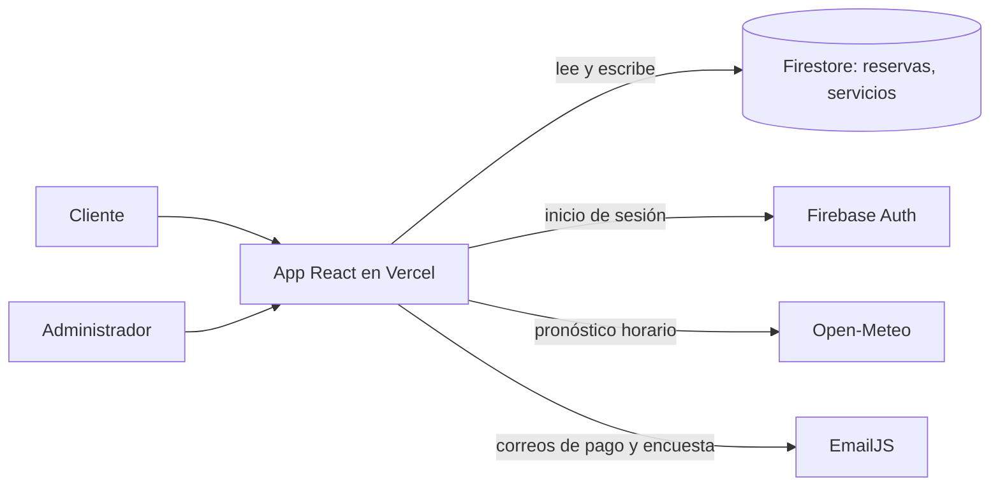
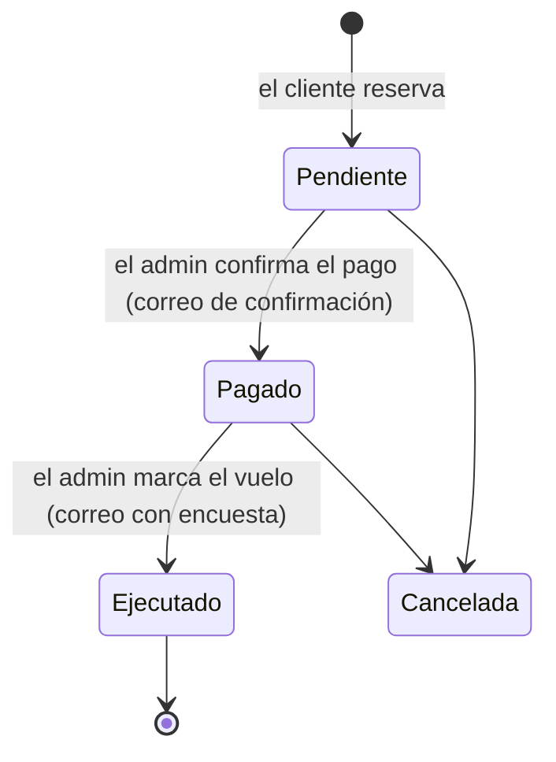

# Guía de onboarding — FlyAdventure

Esta guía es para quien se incorpore al equipo o retome el proyecto después de un tiempo. Al terminarla deberías tener la plataforma corriendo en tu equipo, entender cómo se conectan sus piezas y saber a quién acudir.

> **Primeros 15 minutos:** instala Node.js, clona el repositorio, ejecuta `npm install` y `npm run dev`, y abre `http://localhost:5173`. El resto de la guía explica lo que acabas de levantar.

---

## 1. Qué es FlyAdventure

FlyAdventure es una plataforma web para un operador de parapente en San Félix (Bello, Antioquia). Permite a los clientes consultar los servicios de vuelo y reservar, y al operador gestionar reservas, servicios, pagos y encuestas de satisfacción desde un panel administrativo.

La plataforma se construyó en una materia anterior. En **Proyecto de Aula (TdeA, 2026)** se retoma para agregar ajustes y un valor agregado basado en inteligencia artificial, además de la pasarela Mercado Pago en modo sandbox. El alcance completo está en los requisitos RF001 a RF020 del documento PPI.

## 2. Equipo y a quién preguntar

| Persona | Rol | Pregúntale por |
|---|---|---|
| Jose Alejandro Colorado | Analista y Líder | Requisitos, alcance, prioridades, documentación PPI y diagramas |
| Joselin Lisboa | Desarrolladora | Código, Firebase, despliegue en Vercel, tablero de Trello |
| Linay Muñoz | QA | Pruebas, criterios de aceptación y reporte de errores |

Las historias de usuario viven en Trello ("My Trello board", del workspace que comparte Joselin). Cada tarjeta se titula `HUxxx - <nombre>`, lleva la historia en la descripción y dos checklists: **Criterios de aceptación** y **Criterios no funcionales** (con el código RNF entre paréntesis).

## 3. Preparar el entorno

**Requisitos:**

- **Node.js 20.19 o superior** (se recomienda la versión 22 LTS). Vite 8 no funciona con versiones anteriores.
- **Git** y acceso al repositorio `https://github.com/josealejandrocr2001/FlyAdventure`.
- **Un editor.** Se recomienda VS Code con la extensión de ESLint.
- **Acceso al proyecto de Firebase** `fly-adventure-9e6bd`. Pídelo a Joselin; sin él puedes correr la página, pero no ver los datos en la consola de Firebase.

**Pasos:**

```bash
git clone https://github.com/josealejandrocr2001/FlyAdventure.git
cd FlyAdventure
npm install
npm run dev
```

Abre `http://localhost:5173`. Si carga la página de inicio y en `/vuelos` aparecen los servicios, el entorno quedó listo y está conectado a Firebase.

**Scripts disponibles:**

| Comando | Qué hace |
|---|---|
| `npm run dev` | Servidor de desarrollo con recarga en caliente |
| `npm run build` | Genera la versión de producción en `dist/` |
| `npm run preview` | Sirve localmente lo generado por `build`, para probarlo antes de desplegar |
| `npm run lint` | Revisa el código con ESLint; ejecútalo antes de cada commit |

**Para entrar al panel administrativo** ve a `/admin` e inicia sesión con una cuenta creada en Firebase Authentication. Las cuentas no se comparten por chat: pídele a Joselin que te cree la tuya.

## 4. Cómo está construido

| Capa | Tecnología |
|---|---|
| Interfaz | React 19 + Vite 8, React Router 7 |
| Estilos | Bootstrap 5, Bootstrap Icons, styled-components y CSS por página |
| Datos | Cloud Firestore (base de datos NoSQL de Firebase) |
| Autenticación | Firebase Authentication (correo y contraseña) |
| Correos | EmailJS, enviado desde el navegador |
| Gráficas del panel | Chart.js con react-chartjs-2 |
| Clima | API pública de Open-Meteo |
| Despliegue | Vercel (`https://fly-adventure.vercel.app`) |

No hay backend propio: el navegador habla directamente con Firebase, EmailJS y Open-Meteo.



Esto cambia con el valor agregado. La pasarela de pagos y los servicios de IA requieren una capa de servicios en el servidor, porque sus credenciales no pueden quedar expuestas en el navegador (RF008, RF009 y requisitos de seguridad del PPI).

### Estructura del código

```
src/
├── App.jsx              Rutas y protección del panel (ProtectedRoute)
├── main.jsx             Punto de entrada
├── config/firebase.js   Inicialización de Firebase (db y auth)
├── components/          Header y Footer compartidos
├── pages/               Una página por ruta (Home, Booking, Flights, AdminPanel…)
├── services/            Lógica reutilizable sin interfaz
│   ├── serviciosVuelos.js   Carga y formato del catálogo de servicios
│   └── pronosticoClima.js   Consulta a Open-Meteo y recomendación de vuelo
└── styles/              Estilos con styled-components por página
```

**Regla de la casa:** la lógica que habla con Firebase o con APIs externas va en `services/`, no dentro de las páginas. `pronosticoClima.js` es el ejemplo a seguir.

### Rutas

| Ruta | Página | Acceso |
|---|---|---|
| `/` | Inicio | Público |
| `/vuelos` | Catálogo de servicios | Público |
| `/reservar` | Formulario de reserva con disponibilidad y clima | Público |
| `/nosotros` | Información del operador | Público |
| `/encuesta/:id` | Encuesta de satisfacción (el `id` es el de la reserva) | Público, llega por correo |
| `/admin` | Inicio de sesión | Público |
| `/admin-panel` | Panel: reservas, servicios, indicadores | Requiere sesión |

`vercel.json` redirige todas las rutas a `index.html`. Sin esa regla, recargar una ruta interna en producción da error 404.

### Datos en Firestore

**`servicios`**: el catálogo de vuelos. Campos principales: `titulo`, `descripcion`, `precio` e `imagen`, más `activo`, que es booleano. Un servicio sin el campo `activo` se considera disponible.

**`reservas`**: una por solicitud de vuelo. Guarda los datos del pasajero (`documento`, `nombre`, `email`, `telefono`, `peso`, `edad`), los del vuelo (`tipoVuelo`, que es el *título* del servicio y no su id, `fecha`, `hora` y `observaciones`), el `estado` y, tras la encuesta, `satisfaccion` y `comentarioSatisfaccion`.

### Ciclo de vida de una reserva



La reserva se valida en el navegador. Los bloques van de 9:00 a 16:00 cada 30 minutos, y un bloque se bloquea cuando se llena su cupo. El pronóstico se consulta en Open-Meteo: si el clima es "no recomendable", el sistema no permite reservar ese bloque. Hoy el pago se acuerda por WhatsApp y el administrador lo confirma a mano en el panel.

## 5. Tareas comunes

**Agregar una página nueva**

1. Crea el componente en `src/pages/MiPagina.jsx`.
2. Regístralo en `App.jsx` dentro de `<Routes>`. Si es solo para el equipo, envuélvelo en `<ProtectedRoute>`.
3. Si necesita datos, crea o reutiliza una función en `src/services/`.
4. Agrega el enlace en `Header.jsx` si debe aparecer en el menú.

**Probar el flujo completo de una reserva**

1. En `/reservar`, crea una reserva con tu propio correo, en una fecha cercana para que haya pronóstico.
2. En `/admin-panel`, confirma el pago y verifica que llegue el correo de confirmación.
3. Marca el vuelo como ejecutado y abre el enlace de la encuesta que llega por correo.
4. Responde la encuesta y comprueba que la satisfacción aparezca en los indicadores.

Usa datos de prueba identificables (por ejemplo, el nombre "PRUEBA QA") y cancela esas reservas al terminar, porque la base de datos es la misma que usa producción.

**Trabajar con Git**

1. Actualiza `main` con `git pull`.
2. Crea una rama por historia: `git checkout -b feature/HU012-asignar-piloto`.
3. Haz commits pequeños con mensajes claros y ejecuta `npm run lint` antes de subir.
4. Abre un Pull Request hacia `main` y pide revisión a otra persona del equipo; Linay valida contra los criterios de aceptación de la tarjeta.

Nunca hagas `push` directo a `main`: es la rama que se publica en Vercel.

**Desplegar.** La versión publicada sale de la rama `main`. Confirma con Joselin si el proyecto de Vercel despliega automáticamente al fusionar o si se hace a mano, y pídele acceso para revisar los despliegues y sus errores.

## 6. Cosas que conviene saber (y que están en el backlog)

Esto no bloquea tu trabajo, pero te va a ahorrar horas de confusión:

- **Los estados de la reserva no son uniformes.** El panel escribe `"Pagado"`, `"Ejecutado"` y `"Cancelada"`, mientras que los indicadores normalizan todas las variantes (`confirmada`, `pagado`, `eliminado`…) con `obtenerEstadoReserva()` en `AdminPanel.jsx`. Si agregas un estado nuevo, agrégalo también ahí.
- **Las credenciales están en el código.** La configuración de Firebase y los identificadores de EmailJS están escritos directamente en `firebase.js` y `AdminPanel.jsx`. Las claves web de Firebase y EmailJS son públicas por diseño, pero lo que realmente protege los datos son las **reglas de seguridad de Firestore**; hay que revisarlas. Lo correcto es moverlas a variables de entorno (`.env.local` con prefijo `VITE_`, que ya está excluido por `.gitignore`). Las claves de Mercado Pago y del proveedor de IA **nunca** deben ir en el frontend.
- **El panel solo verifica que haya sesión, no el rol.** Cualquier cuenta de Firebase Auth entra a todo el panel. Los perfiles de administrador, operador y piloto (RF016) aún no existen.
- **El enlace de la encuesta tiene una doble barra** (`vercel.app//encuesta/...`). Funciona, pero conviene corregirlo.
- **`Booking.jsx` carga los servicios dos veces** (hay dos `useEffect` que hacen lo mismo). Se puede eliminar el primero.

## 7. Dónde está todo lo demás

| Recurso | Ubicación |
|---|---|
| Documento PPI (requisitos RF y RNF, objetivos) | `Documentación FlyAdventure/Proyecto PPI FlyAdventure.docx` |
| Diagrama de casos de uso | `Documentación FlyAdventure/Casos de Uso FlyAdventure.drawio` |
| Diagrama de clases | `Documentación FlyAdventure/Diagrama de Clases FlyAdventure.drawio` |
| Diagrama entidad-relación (modelo de datos) | `Documentación FlyAdventure/Diagrama Entidad-Relacion FlyAdventure.drawio` |
| Presentación de sustentación | `Documentación FlyAdventure/FlyAdventure - Sustentacion.pptx` |
| Historias de usuario | Trello, "My Trello board" |
| Microcurrículo y rúbrica de la materia | `Documentos Proyecto de aula/Semana 1/FO-DOC-20 PROYECTO DE AULA 2026.docx` |
| Registro de prompts de IA | `Documentación FlyAdventure/Prompts/` |

Si algo de esta guía ya no coincide con el código, corrígelo en el mismo Pull Request que introduce el cambio. Una guía desactualizada es peor que no tener guía.
